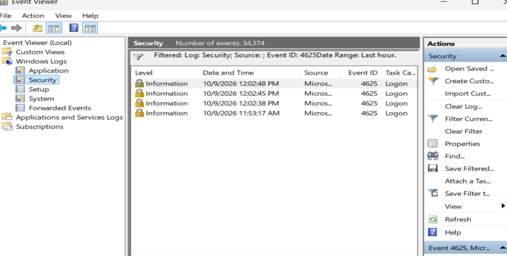
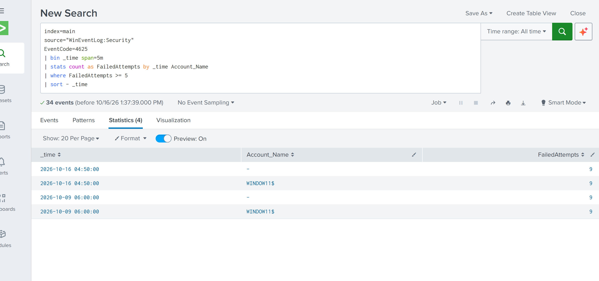
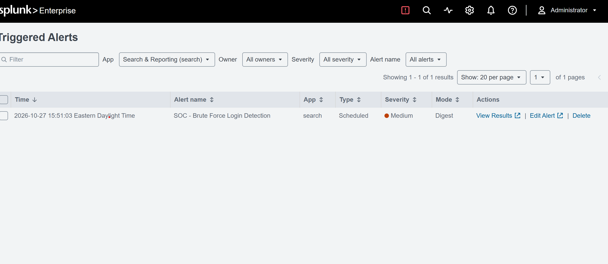
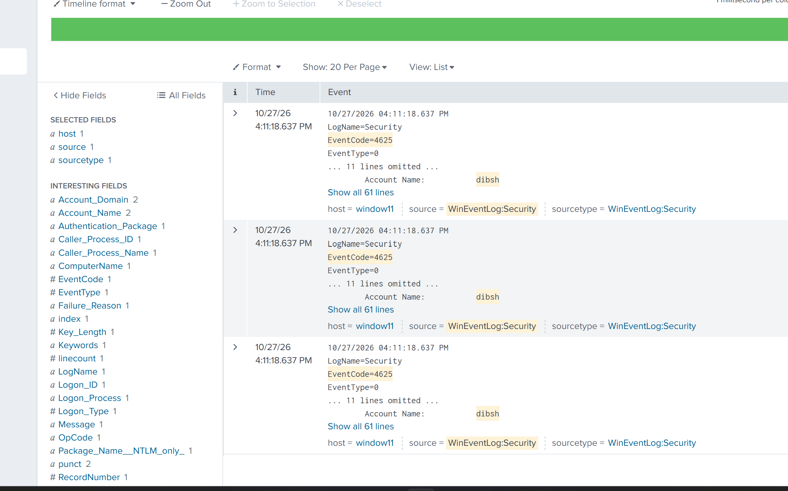
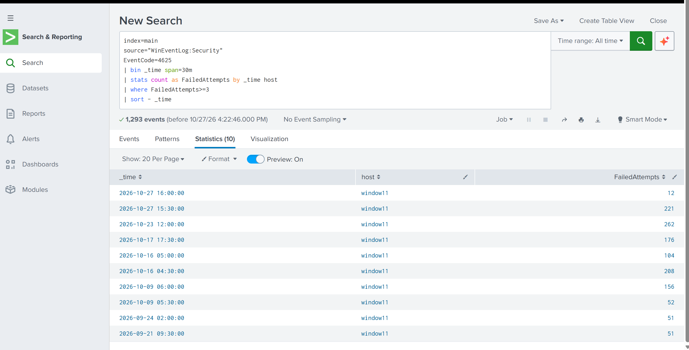

# Windows Failed Login Detection & SOC Investigation Using Splunk

**SOC Portfolio Project 01 | Detection Engineering | Security Monitoring | Incident Investigation**

## Project Overview

This project demonstrates the collection, detection, and investigation of repeated Windows authentication failures using Splunk Enterprise.

I built a Windows 11 virtual lab, configured Splunk Universal Forwarder to transmit Windows Security logs to Splunk Enterprise, developed an SPL detection rule, validated alert functionality, and investigated authentication events.

The final detection identified up to **12 failed authentication events on a single host within a fixed 30-minute interval**.

## Lab Architecture

**Windows 11 VM → Splunk Universal Forwarder → Splunk Enterprise → SPL Detection → SOC Investigation**

| Component | Technology |
|---|---|
| Endpoint | Windows 11 Virtual Machine |
| Virtualization | Oracle VirtualBox |
| SIEM | Splunk Enterprise |
| Log Collection | Splunk Universal Forwarder |
| Log Source | Windows Security Event Logs |
| Security Event | Event ID 4625 |
| Detection Language | Splunk SPL |
| Framework | MITRE ATT&CK |

## Project Objectives

- Collect Windows Security events in a centralized SIEM.
- Identify repeated failed authentication attempts.
- Develop and validate an SPL detection rule.
- Configure and test scheduled alerting.
- Investigate authentication anomalies.
- Document findings using SOC reporting practices.

## Detection Rule

The final detection identifies hosts with three or more failed authentication events in fixed 30-minute intervals.

```spl
index=main
source="WinEventLog:Security"
EventCode=4625
| bin _time span=30m
| stats count as FailedAttempts by _time host
| where FailedAttempts>=3
| sort - _time
```

**Detection threshold:** 3 or more failed authentication events per host per 30-minute bucket.

**Maximum observed:** 12 events in one interval.

The query is also available in [detection.spl](detection.spl).

## Investigation Findings

Windows Event ID 4625 records were successfully forwarded from the Windows 11 virtual machine into Splunk.

During investigation, some events showed `WINDOW11$` as the subject computer account rather than an identified failed target account. An inspected event also contained the loopback address `127.0.0.1` and the process `svchost.exe`.

An earlier scheduled alert successfully triggered during testing. The final host-based detection was subsequently validated through SPL search, but was not verified as deployed in the scheduled alert.

**Analyst assessment:** Repeated authentication failures were observed; a malicious brute-force attack was not confirmed.

## MITRE ATT&CK Mapping

**Tactic:** Credential Access  
**Technique:** [T1110 — Brute Force](https://attack.mitre.org/techniques/T1110/)

Repeated failed logons may indicate password guessing, but they can also result from legitimate authentication errors or background services.

This project demonstrates a detection use case relevant to T1110, not confirmation that an attacker executed the technique.

## Evidence Screenshots

### Windows Failed Logon Event



### Initial Splunk Detection



### Triggered Splunk Alert



### Authentication Event Investigation



### Final Detection Rule



## Project Documentation

- [SPL Detection Rule](detection.spl)
- [SOC Incident Investigation Report](incident-report.md)
- [MITRE ATT&CK Mapping](mitre-attack.md)
- [Alert Configuration and Validation](alert-configuration.md)

## Limitations and Future Improvements

- Improve failed target-account extraction.
- Correlate failed logons with source IP addresses and usernames.
- Distinguish local service failures from suspicious authentication activity.
- Investigate successful logons following repeated failures.
- Tune alert thresholds and validate the final rule as a scheduled alert.

## Skills Demonstrated

**SIEM Monitoring · Splunk SPL · Windows Event Analysis · Log Forwarding · Detection Engineering · Alert Validation · SOC Investigation · MITRE ATT&CK Mapping · Technical Documentation**

## Conclusion

This project demonstrates a practical SOC workflow, from endpoint log collection through detection development, alert validation, investigation, and documentation.

It also highlights the importance of verifying raw security events and distinguishing suspicious indicators from confirmed malicious activity.
