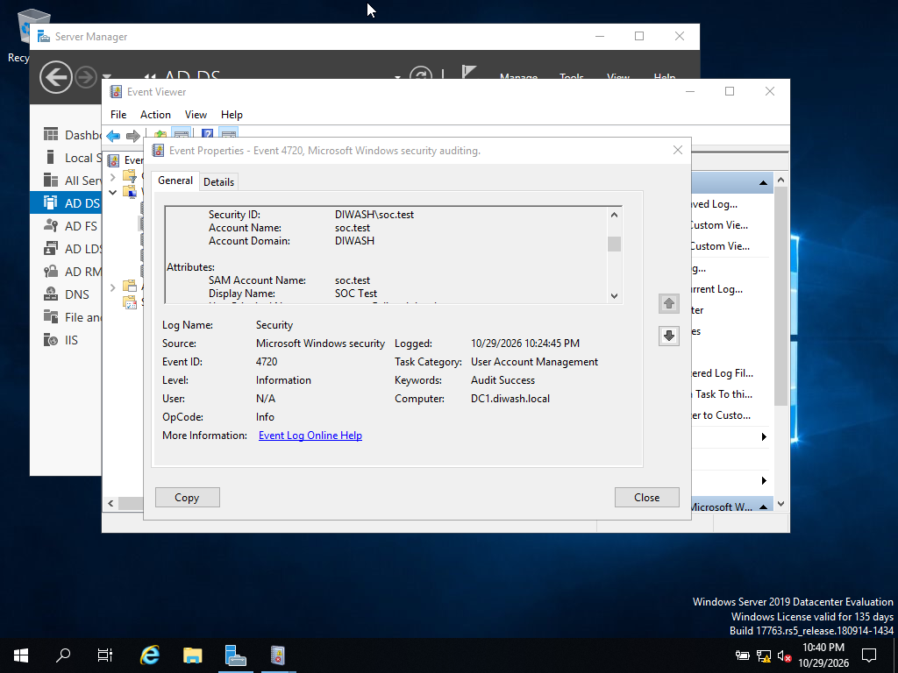
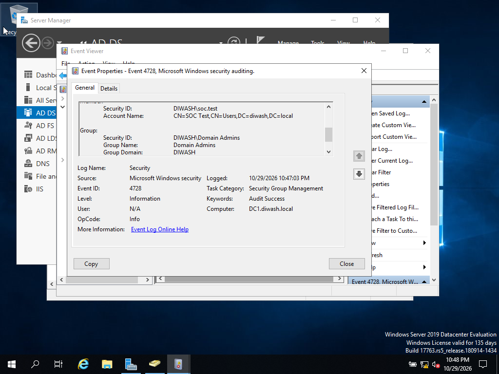
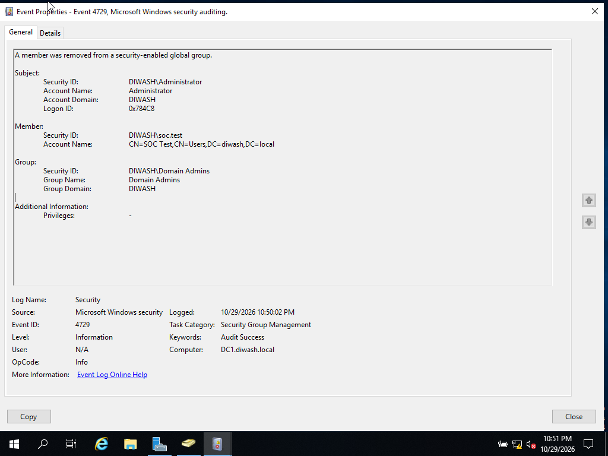

# Active Directory Investigation

**SOC Portfolio Project 02 | Windows Security Logs | Identity Investigation**

**Status: Completed — manual lab investigation supported by three screenshots.**

## Overview

Created a test domain user, temporarily added it to Domain Admins, identified the resulting Windows Security events in Event Viewer, and documented removal of the privileged membership. This was an authorized lab exercise, not a confirmed security incident. No SIEM or automated alert deployment is claimed.

## Environment

| Component | Observed value |
|---|---|
| Operating system | Windows Server 2019 Datacenter Evaluation |
| Domain controller | `DC1.diwash.local` |
| Domain | `diwash.local` / `DIWASH` |
| Test account | `DIWASH\soc.test` |
| Display name | `SOC Test` |
| Privileged group | `DIWASH\Domain Admins` |
| Tools | Active Directory Users and Computers; Windows Event Viewer |
| Evidence | Security log screenshots, events 4720, 4728, 4729 |

## Investigation timeline

Times below are exactly as displayed by Event Viewer on October 29, 2026. The VM's time zone was not captured; no UTC conversion is assumed.

| Displayed time | Event | Finding |
|---|---|---|
| 10:24:45 PM | 4720 | `soc.test` created in `DIWASH` |
| 10:47:03 PM | 4728 | `soc.test` added to Domain Admins |
| 10:50:02 PM | 4729 | `soc.test` removed from Domain Admins |

The recorded addition and removal are **2 minutes 59 seconds apart**. This measures the interval between the recorded membership changes, not the lifetime of any existing access token or session.

The lab operator confirmed `DIWASH\Administrator` performed all three actions. The removal screenshot independently shows that Subject account; the creation and addition screenshots do not expose their Subject sections.

## Evidence

### 1. User creation — Event 4720

### 2. Privileged group addition — Event 4728

### 3. Membership removal — Event 4729

## Project documentation

- [Investigation report](incident-report.md)
- [Detection and event review](detection-guide.md)
- [Lab workflow](lab-workflow.md)
- [MITRE ATT&CK mapping](mitre-attack.md)
- [Evidence inventory and limitations](screenshots/README.md)

## Outcome

The evidence supports account creation, temporary privileged membership, and subsequent removal. The test account was retained according to the lab workflow. No account deletion, malicious use, successful privileged logon, or current effective-access verification is claimed.

**Skills demonstrated:** AD user and group administration, Windows event filtering, timeline reconstruction, actor/member/group attribution, cleanup verification through an audit event, and evidence-based reporting.
